<div align="center">


# Kapra

**A full-stack MERN clothing store with a customer storefront, an admin panel and secure Stripe checkout.**

[**Live Store**](https://forever-full-statck.vercel.app) · [**Admin Panel**](https://forever-admin-pied-ten.vercel.app) · [Features](#-features) · [Screenshots](#-screenshots) · [Run locally](#-run-locally)


<br />

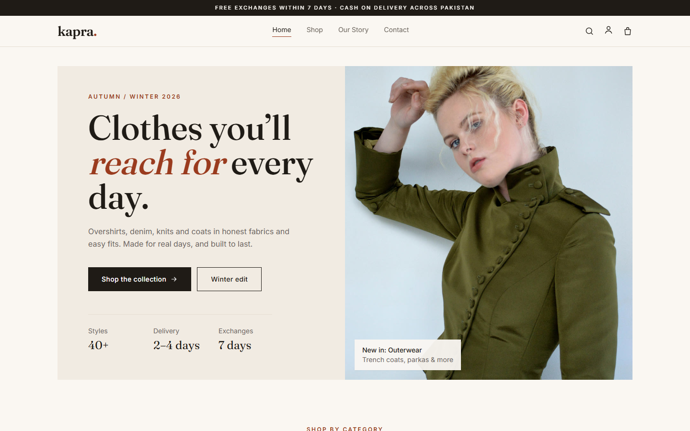

</div>

---

## 📌 Overview

Kapra is an online clothing store for men, women and kids, built as three apps that share one REST API:

| App | What it does | Stack |
|---|---|---|
| **Storefront** (`frontend/`) | Browse, filter and search products, manage a bag, check out with cash on delivery or Stripe, track orders | React 19, Vite, Tailwind CSS |
| **Admin panel** (`admin/`) | Sales dashboard, product management with image upload, order management with status updates | React 19, Vite, Tailwind CSS |
| **API** (`backend/`) | Auth, products, cart, orders and payments | Node.js, Express 5, MongoDB, Cloudinary, Stripe |

> **Try the admin panel safely:** click **“Explore the demo”** on the admin login, or sign in with `demo@kapra.store` / `demo1234`. The demo account is **read-only on the server**: it can view everything, customer details are masked, and every write request is rejected.

---

## ✨ Features

<table>
<tr>
<td width="50%" valign="top">

### 🛍️ Storefront
- Home page with hero, category tiles, new arrivals and bestsellers
- Shop page with category and type filters (kept in the URL, so links are shareable), search across names and descriptions, and price sorting
- Product page with image gallery, size picker, details tabs and related products
- Bag that syncs to the user's account across devices
- Checkout with **cash on delivery** or **Stripe card payments**
- Order history with a 5-step delivery tracker
- Skeleton loaders, empty states, 404 page, responsive mobile menu

</td>
<td width="50%" valign="top">

### 🧑‍💼 Admin panel
- Dashboard: revenue, orders, average order value, product counts and recent orders
- Products table with search, category filter and delete (images are removed from Cloudinary too)
- Add product form with up to 4 images, sizes, category and bestseller flag
- Orders board with status filters and inline status updates
- **Read-only demo mode** for portfolio visitors

</td>
</tr>
<tr>
<td colspan="2" valign="top">

### 🔐 Backend & security
- JWT auth for customers (7-day expiry) and admins (1-day expiry, **role-only payload**, no credentials inside the token)
- **Server-side pricing:** order totals are rebuilt from the database, so a tampered price in the browser has no effect; sizes and quantities are validated
- **Verified Stripe payments:** an order is marked paid only after the Stripe Checkout Session reports `paid`, not because of a URL parameter
- Passwords hashed with bcrypt; email validation and minimum password length on sign-up
- CORS allow-list for the store and admin domains
- Consistent JSON responses with proper HTTP status codes (400, 401, 403, 404, 500)

</td>
</tr>
</table>

---

## 📸 Screenshots

| Shop with filters | Product page |
|:---:|:---:|
| 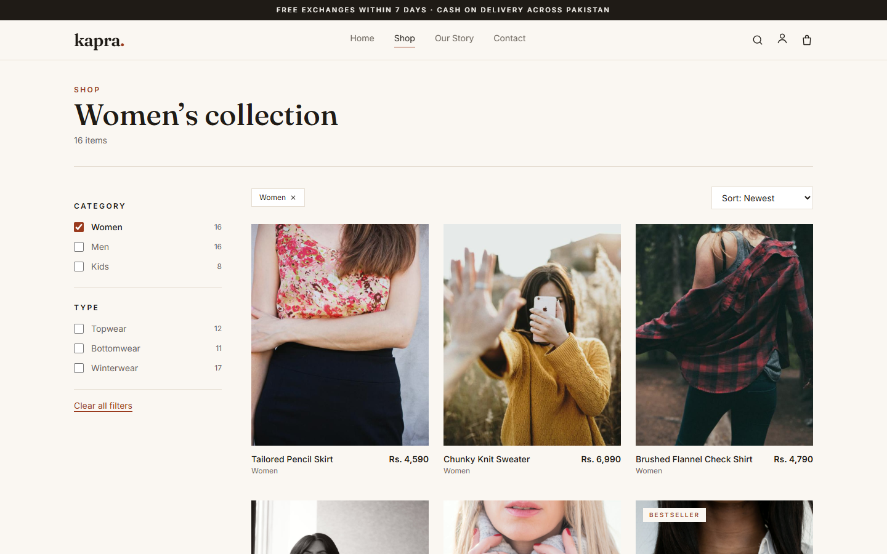 | 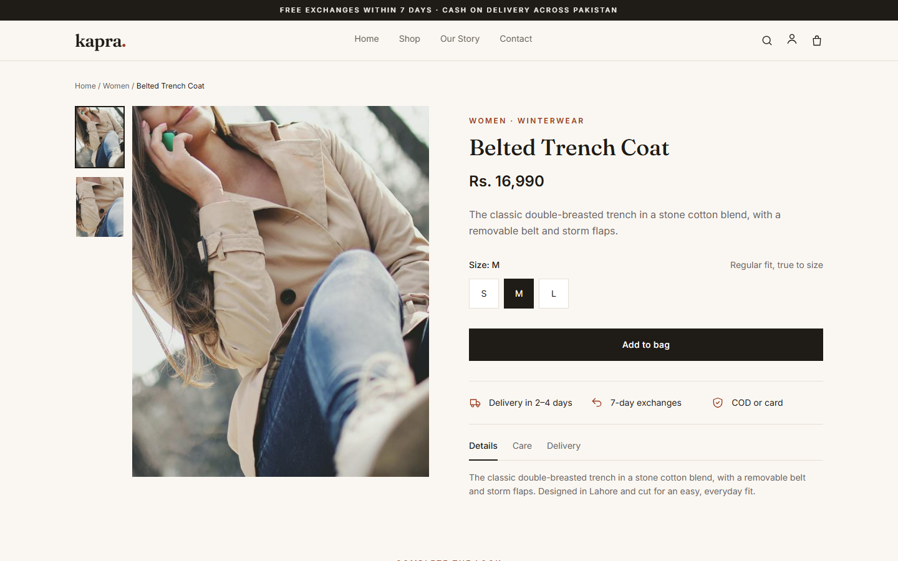 |
| **Bag** | **Checkout** |
| 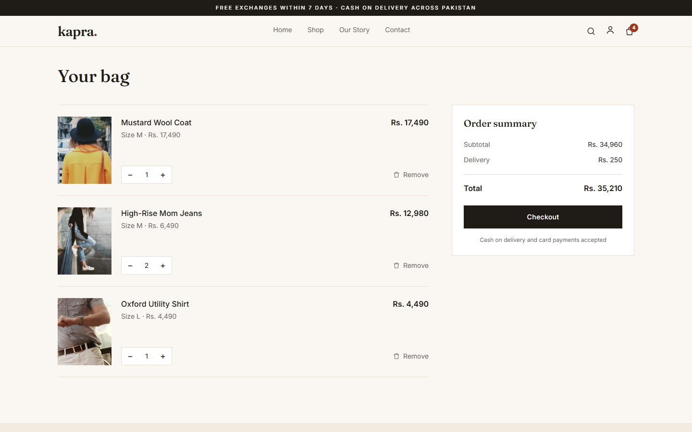 | 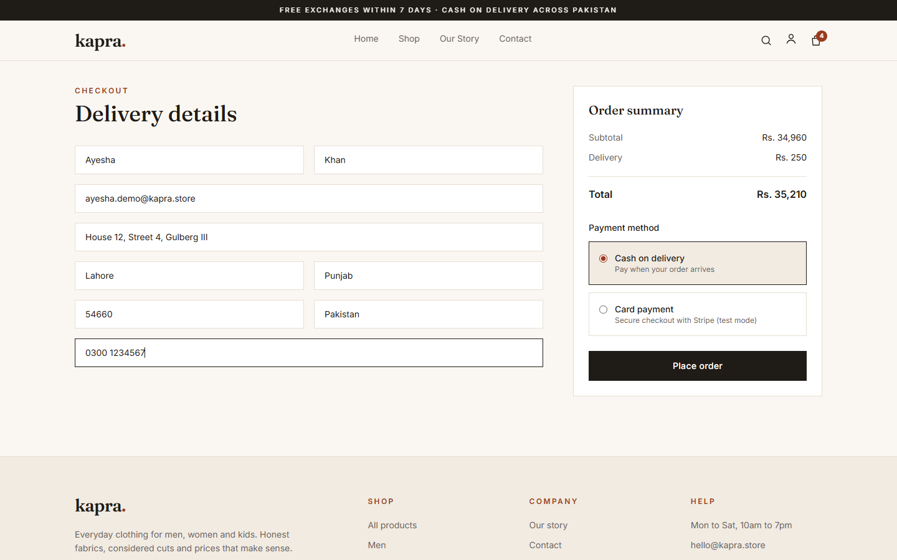 |
| **Order tracking** | **Admin login with demo access** |
| 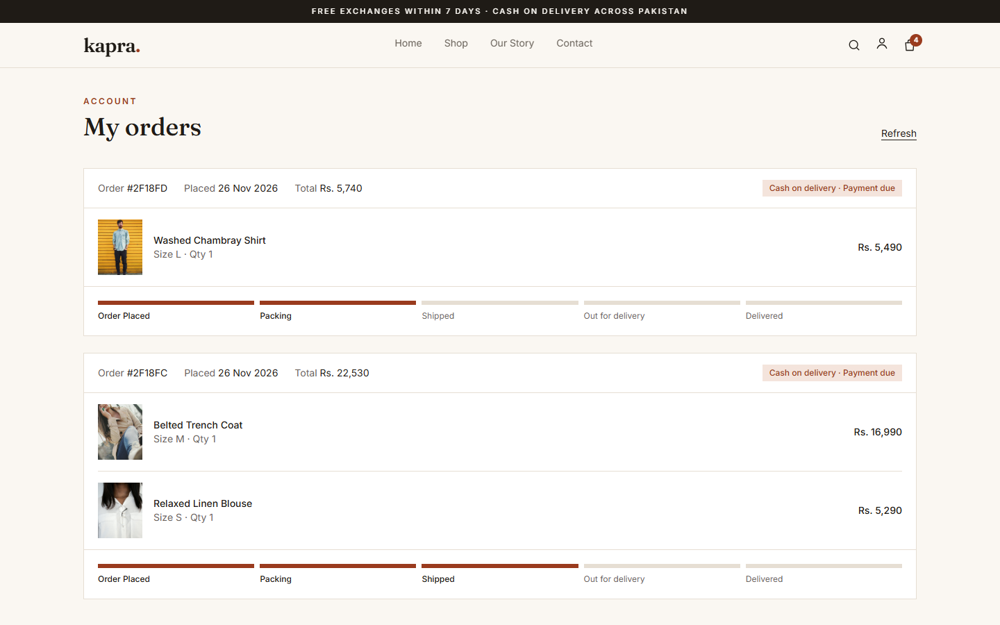 | 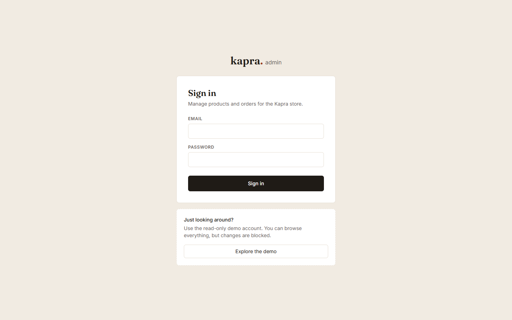 |
| **Admin dashboard** | **Admin orders** |
| 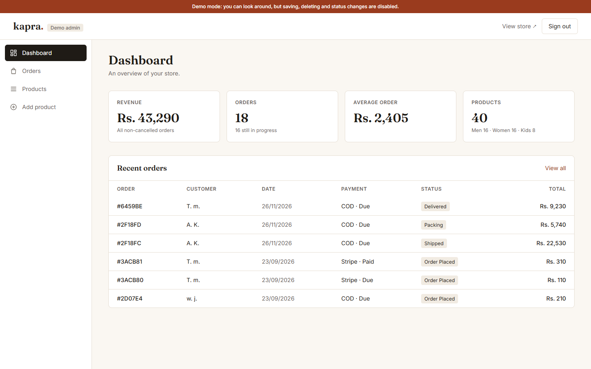 | 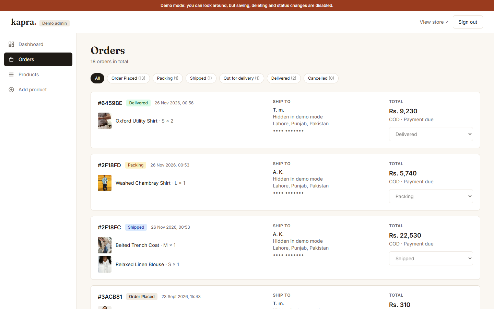 |
| **Admin products** | **Add product** |
| 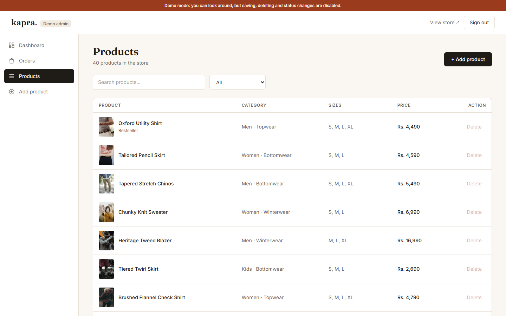 | 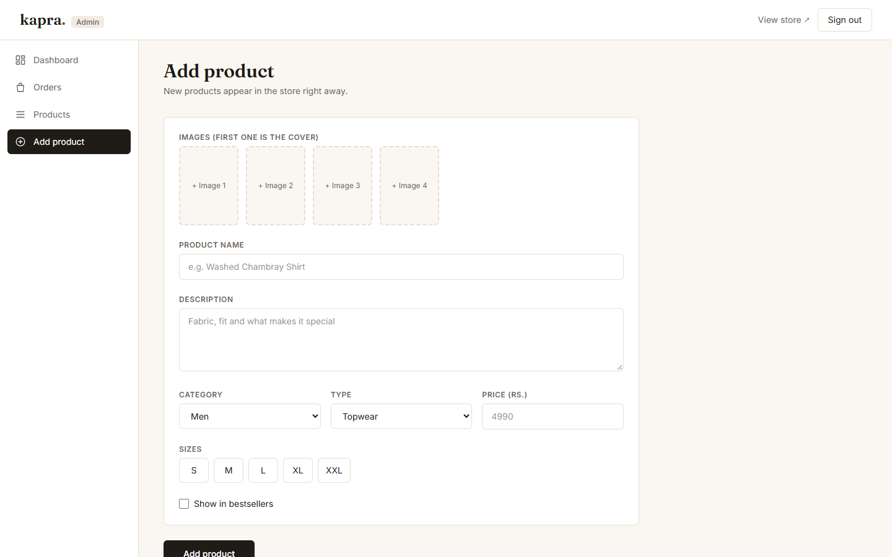 |

<details>
<summary><b>📱 Mobile view</b></summary>
<br />
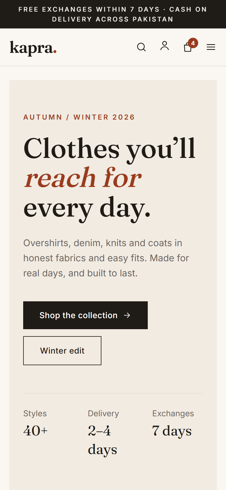
</details>

---

## 🏗️ Architecture

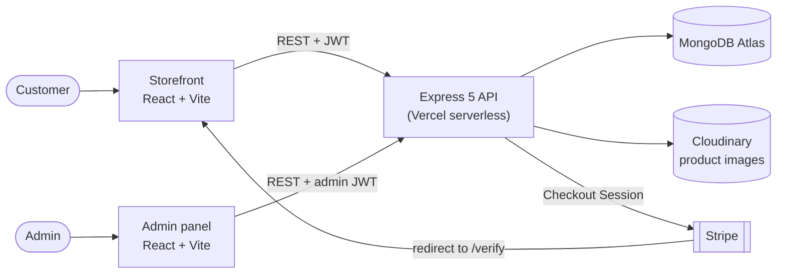

**Checkout flow (card):** the API creates the order from database prices, opens a Stripe Checkout Session and saves its id. After payment Stripe redirects to `/verify`; the API retrieves the session from Stripe and only then marks the order as paid and clears the bag.

---

## 🧰 Tech Stack

| Layer | Technologies |
|---|---|
| **Frontend & admin** | React 19, React Router 7, Vite, Tailwind CSS, Axios, React Toastify |
| **Backend** | Node.js, Express 5, Mongoose, Multer, JSON Web Tokens, bcrypt, validator |
| **Services** | MongoDB Atlas, Cloudinary, Stripe Checkout |
| **Hosting** | Vercel (store, admin and API) |

---

## 🔌 API Overview

| Resource | Endpoint | Access |
|---|---|---|
| **Users** | `POST /api/users/register` · `POST /api/users/login` | Public |
| | `POST /api/users/admin` | Public (returns an `admin` or `demo` token) |
| **Products** | `GET /api/product/list` · `POST /api/product/single` | Public |
| | `POST /api/product/add` (multipart, up to 4 images) · `POST /api/product/remove` | Admin |
| **Cart** | `POST /api/cart/get` · `POST /api/cart/add` · `POST /api/cart/update` | Customer |
| **Orders** | `POST /api/order/place` (COD) · `POST /api/order/stripe` · `POST /api/order/verifyStripe` · `POST /api/order/userorders` | Customer |
| | `POST /api/order/list` | Admin and demo (demo sees masked addresses) |
| | `POST /api/order/status` | Admin |

Auth tokens are sent in a `token` request header.

---

## 🚀 Run Locally

**Prerequisites:** Node.js 18+, a MongoDB database, a Cloudinary account and a Stripe account (test mode is fine).

```bash
git clone https://github.com/WaleedAkram01/forever-full-statck.git
cd forever-full-statck

# API (http://localhost:9000)
cd backend && npm install
# create backend/.env (see below)
npm start

# Storefront (http://localhost:5173)
cd ../frontend && npm install
echo "VITE_BACKEND_URL=http://localhost:9000" > .env
npm run dev

# Admin panel (http://localhost:5174)
cd ../admin && npm install
echo "VITE_BACKEND_URL=http://localhost:9000" > .env
npm run dev
```

### Environment variables

| Key | App | Description |
|---|---|---|
| `MONGODB_URI` | backend | MongoDB connection string |
| `JWT_SECRET` | backend | Secret used to sign all tokens (use a long random value) |
| `ADMIN_EMAIL` / `ADMIN_PASSWORD` | backend | Full-access admin login (use a strong password, 12+ characters) |
| `CLOUDINARY_NAME` / `CLOUDINARY_API_KEY` / `CLOUDINARY_SECRET_KEY` | backend | Cloudinary credentials for product images |
| `STRIPE_SECRET_KEY` | backend | Stripe secret key (`sk_test_…` for testing) |
| `DEMO_ADMIN_EMAIL` / `DEMO_ADMIN_PASSWORD` | backend | Optional. Read-only demo login (defaults to `demo@kapra.store` / `demo1234`) |
| `DEMO_ADMIN_ENABLED` | backend | Optional. Set to `false` to turn the demo account off |
| `PORT` | backend | Optional. Defaults to `9000` |
| `VITE_BACKEND_URL` | frontend, admin | Base URL of the API |

Stripe test card: `4242 4242 4242 4242`, any future date, any CVC.

---

## 📁 Project Structure

```
forever-full-statck/
├── backend/
│   ├── config/         # MongoDB and Cloudinary setup
│   ├── controllers/    # user, product, cart and order logic
│   ├── middlewares/    # customer auth, admin/demo auth, file uploads
│   ├── models/         # user, product, order schemas
│   ├── routes/
│   └── server.js
├── frontend/
│   └── src/
│       ├── components/ # Navbar, Hero, ProductItem, CategoryTiles, Icons...
│       ├── context/    # ShopContext: products, bag, auth
│       └── pages/      # Home, Collection, Product, Cart, PlaceOrder, Orders...
├── admin/
│   └── src/
│       ├── components/ # Login, Navbar, SideBar
│       └── pages/      # Dashboard, List, Add, Orders
└── docs/screenshots/
```

---

## 🗺️ Roadmap

- [ ] Edit existing products from the admin panel
- [ ] Stock levels per size
- [ ] Stripe webhooks as a second confirmation path
- [ ] Wishlist and product reviews
- [ ] Order confirmation emails

---

## 📝 Background & credits

This project started as a learning build following a MERN e-commerce course. It was later rebuilt into Kapra: a new brand and UI for both apps, a new product catalogue, an admin dashboard and demo mode, and a hardened backend (role-based admin tokens, server-side pricing and verified Stripe payments).

Product and lifestyle photos are CC0 images from [StockSnap](https://stocksnap.io), found via [Openverse](https://openverse.org). Kapra is a portfolio project, not a real shop.

## 👤 Author

**Waleed Akram**, Full-Stack Developer (MERN, Next.js)
GitHub: [@WaleedAkram01](https://github.com/WaleedAkram01)
